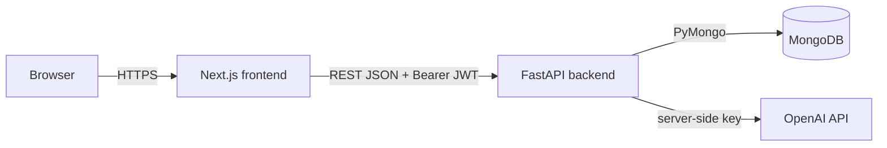

# Mini Tasks

A task manager: sign up / sign in, create / update / delete tasks, filter by status or "due this week", and an optional AI "Suggest due date" button.

| | URL |
|---|---|
| Web app | `https://<your-frontend-url>` |
| API base | `https://<your-api-url>` (docs at `/docs`, health at `/health`) |
| Demo user | `demo@minitasks.dev` / `DemoPass123!` (non-admin) |

## Stack
Next.js 14 (App Router, JavaScript) · FastAPI (Python 3.12) · MongoDB · JWT (PyJWT) + bcrypt · OpenAI `gpt-4o-mini` (optional)

## Architecture



```
backend/app/
  main.py        app, CORS, security headers, /health
  config.py      env-based settings
  security.py    bcrypt hashing + JWT
  deps.py        get_current_user dependency
  schemas.py     Pydantic validation models
  routers/       auth.py, tasks.py, ai.py
frontend/
  app/           pages: /login /signup /dashboard
  components/    AuthForm, TaskForm
  lib/api.ts     typed fetch wrapper + session helpers
```

### API
| Method | Path | Notes |
|---|---|---|
| POST | `/auth/signup` | 201, 409 duplicate email, 422 validation |
| POST | `/auth/login` | 200, 401 invalid credentials |
| GET | `/auth/me` | current user |
| GET | `/tasks?status=&due_this_week=` | only the caller's tasks |
| POST | `/tasks` | 201 |
| GET / PATCH / DELETE | `/tasks/{id}` | 404 if missing or not yours; DELETE → 204 |
| POST | `/ai/suggest-due-date` | `{title, description}` → `{due_date, reason}` |
| GET | `/health` | pings MongoDB |

## Run locally

### Option A: Docker
```bash
export OPENAI_API_KEY=sk-...   # optional
docker compose up --build
# web: http://localhost:3000   api: http://localhost:8000/docs
docker compose exec backend python -m scripts.seed_demo   # create demo user
```

### Option B: manually
```bash
# Backend (needs a MongoDB on localhost:27017 or an Atlas URI)
cd backend
python -m venv .venv && source .venv/bin/activate   # Windows: .venv\Scripts\activate
pip install -r requirements-dev.txt
cp .env.example .env                                  # edit values
uvicorn app.main:app --reload                         # http://localhost:8000
python -m scripts.seed_demo                           # optional demo user

# Frontend
cd frontend
cp .env.example .env.local
npm install
npm run dev                                           # http://localhost:3000
```

### Tests
```bash
cd backend && pytest -q     # 9 tests, uses mongomock (no DB needed)
cd frontend && npm run lint && npm run build
```
CI (`.github/workflows/ci.yml`) runs both on every push.

## Environment variables

**Backend** (`backend/.env.example`)
| Var | Purpose |
|---|---|
| `MONGO_URI`, `MONGO_DB` | MongoDB connection |
| `JWT_SECRET` | **Required in production** (app refuses to start without it when `ENV=production`) |
| `JWT_EXPIRE_MINUTES` | token lifetime (default 60) |
| `CORS_ORIGINS` | comma-separated allowed frontend origins |
| `OPENAI_API_KEY`, `OPENAI_MODEL` | optional AI feature; key stays server-side |
| `ENV` | set to `production` when deployed |

**Frontend**: `NEXT_PUBLIC_API_URL`. It is baked in at build time, so set it before building.

## Deployment (DigitalOcean App Platform)
1. Create a MongoDB Atlas free cluster (or a DO Managed MongoDB); allow network access; copy the connection string.
2. Push this repo to GitHub. In DO, create an App with two components from the repo:
   - **backend**: source dir `backend`, Dockerfile build, HTTP port 8000, health check path `/health`. Set env vars above (`ENV=production`, strong `JWT_SECRET`, `MONGO_URI`, `CORS_ORIGINS=https://<frontend-url>`, `OPENAI_API_KEY`).
   - **frontend**: source dir `frontend`, Dockerfile build, HTTP port 3000. Set build-time var `NEXT_PUBLIC_API_URL=https://<backend-url>`.
3. Deploy backend first to get its URL, then set it on the frontend, then add the frontend URL to the backend's `CORS_ORIGINS`.
4. Seed the demo user once (DO console on backend): `python -m scripts.seed_demo`.

## Security notes
- Passwords hashed with bcrypt (salted); 8–72 char limit (bcrypt's 72-byte cap).
- JWT HS256, 60 min expiry, secret from env; login returns the same error for unknown email / wrong password.
- Every task query is scoped by `user_id`, so users cannot read or modify each other's tasks (404, not 403).
- CORS restricted to configured origins and methods; security headers on API and frontend; no secrets in the repo.
- Input validated by Pydantic (lengths, enums, dates, email).

## AI due-date suggestion
- **Flow:** the frontend sends title + description to `/ai/suggest-due-date`; the backend calls OpenAI with the key kept server-side.
- **Prompt:** system prompt gives today's date, asks for JSON only (`due_date`, `reason`), says to honour explicit deadlines, and tells the model the task text is *data, not instructions*.
- **Safeguards:** auth required; input length capped (2000 chars); `response_format=json_object`, low temperature, `max_tokens=120`; output parsed and validated as a date, then clamped to [today, today+365d]; upstream errors become a generic 502 (no leakage); 503 if no key configured; the suggestion only pre-fills the date field, and the user must still save.

## Tradeoffs & future improvements
- **JWT in localStorage**: simple and works across two domains, but exposed to XSS. Better: httpOnly, SameSite cookies with a shared parent domain/proxy plus CSRF protection, and refresh tokens.
- **Dates stored as ISO strings** (`YYYY-MM-DD`): easy range queries, no timezone surprises for date-only values; "this week" uses the server's date (Mon–Sun).
- **No rate limiting** on login or AI endpoints. Would add `slowapi` or a gateway limit and account lockout.
- **Sync PyMongo** in FastAPI's threadpool instead of Motor, for simplicity; async driver would scale better.
- **Realtime**: optimistic UI is implemented for status change and delete (with rollback); SSE/WebSocket sync across tabs is future work.
- **Testing**: backend API tests use mongomock; would add a few frontend component tests (Vitest + Testing Library) and Playwright e2e.
- Pagination, task search, email verification and password reset are not implemented.
